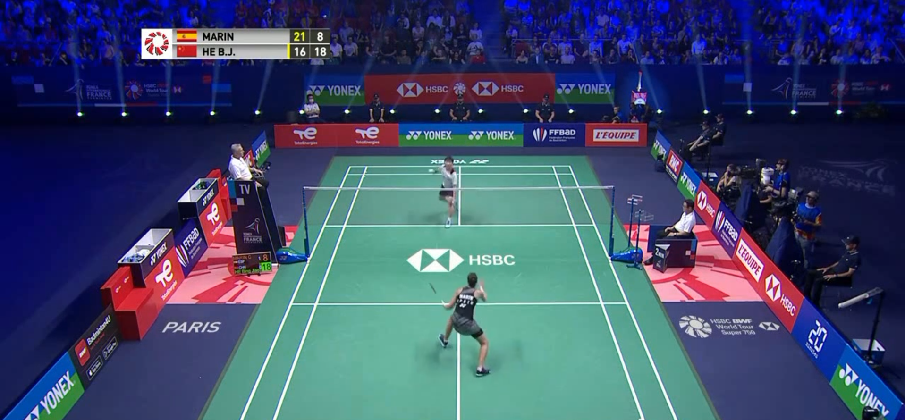

# Badminton AI 🏸

Advanced Computer Vision system for automated badminton match analysis, player tracking with persistent identities, and high-accuracy aerial shuttlecock trajectory detection.



---

## 🌟 Key Features

1. **High-Visibility Player Tracking (Player 1 & 2)**
   - Bold red bounding boxes (`#FF0000`) with solid colored header badges and white text for high contrast against green court surfaces.
   - **`TwoPlayerTracker`**: Spatial court-partition algorithm that stably assigns **Player 1** to the far court (top half) and **Player 2** to the near court (bottom half). Prevents ID flipping or player loss during fast smashes and lunges.

2. **Hybrid Shuttlecock Detector & Flight Tracker (`detect_shuttle.py`)**
   - **Dual-Stream Detection**: Fuses YOLOv8 deep learning proposals with 3-frame symmetric temporal motion differencing ($|F_t - F_{t-1}| \land |F_{t+1} - F_t|$) and white reflectance masking.
   - **3D Flight Airspace Polygon**: Extends tracking vertically above the court floor to capture high clears, lifts, and steep smashes (98.9% tracking coverage).
   - **Physics-Guided Trajectory Predictor**: Employs velocity smoothing, aerodynamic drag, and downward gravity modeling to bridge occlusions across the net.
   - **Telemetry HUD**: Displays real-time estimated flight velocity in **km/h**, tracking status, and broadcast-style fading trajectory trails.

3. **Dedicated Training Pipeline (`train_shuttlecock.py`)**
   - Curated dataset loader with balanced positive (visible shuttlecock) and negative frames.
   - Tuned small-object hyperparameters (`box=8.5`, `mosaic=0.5`, `scale=0.3`, `close_mosaic=3`).
   - Trained model achieving **99.3% precision, 97.7% recall, and 99.4% mAP50**.

---

## 📁 Repository Structure

```text
Badminton AI/
├── output_videos/               # Processed demonstration videos
│   ├── 00467_players_and_shuttle.mp4   # Full match video with players & shuttle
│   └── 00467_shuttle_tracked.mp4       # Dedicated shuttle flight trail & speed HUD
├── sample_dataset/              # Sample broadcast video & preview
│   ├── 00467.mp4                # Match rally sample clip
│   └── 00467img.png             # Frame snapshot
├── training/                    # Dataset & notebook training utilities
│   ├── shuttlecock_yolo_dataset/# YOLO format images, labels & split configs
│   └── shuttlecock_detector_training.ipynb
├── runs/                        # Trained model weights & inference outputs
│   └── detect/shuttlecock/weights/best.pt
├── detect_shuttle.py            # Dedicated shuttlecock detector & speed tracker
├── yolo_inference.py            # Full player & shuttlecock match inference
├── train_shuttlecock.py         # Shuttlecock YOLO fine-tuning script
├── requirements.txt             # Python dependencies
└── README.md
```

---

## 🚀 Quick Start

### 1. Installation
Clone the repository and install dependencies:
```bash
git clone https://github.com/<your-username>/Badminton-AI.git
cd "Badminton AI"
pip install -r requirements.txt
```

### 2. Run Full Match Detection (Players + Shuttlecock)
```bash
python yolo_inference.py sample_dataset/00467.mp4 --person-model yolov8n.pt --output output_videos/match_annotated.mp4
```

### 3. Run Dedicated Shuttlecock Trajectory & Speed Tracker
```bash
python detect_shuttle.py sample_dataset/00467.mp4 --output output_videos/shuttle_trajectory.mp4
```

### 4. Train / Fine-Tune Shuttlecock Model
```bash
python train_shuttlecock.py --epochs 15 --batch 16 --subset 400
```

---

## 🗺️ Court Zones, Next-Zone Prediction & Dashboard

- **Court zones** (`badminton/court.py`): the 4 court corners give a homography from pixels to court metres. Each half is split into 6 zones (F1–F6 far side, N1–N6 near side; 1–3 next to the net, 4–6 near the baseline). Airborne hit points are dropped onto the floor assuming a ~2 m contact height.
- **Shot events** (`badminton/events.py`): hits are found where the shuttle's path turns sharply or speeds up, on a trajectory sampled every 4th frame (the same rate as the training labels). Each shot gets its player, zone, speed and the zone it was sent to.
- **Next-zone predictor** (`badminton/predictor.py`, `train_zone_predictor.py`): a Random Forest uses the hit zone, previous zone, shot speed and the shuttle's first 0.4 s of flight to predict which of the opponent's 6 zones the shuttle goes to. It is trained on the 51 labelled rallies and scored on unseen rallies against simple baselines.
- **Match pipeline** (`analyze_match.py`): players + rackets + shuttle tracking, zones, shots and live predictions → annotated H.264 video, `events.csv` and `summary.json` in `runs/analysis/<video_id>/`.
- **Dashboard** (`app.py`): Streamlit app with the annotated video, shot timeline, zone heatmaps, prediction viewer, model accuracy and player movement.

```bash
# 1. Click the 4 court corners for each video (saved to court_corners.json)
python calibrate_court.py

# 2. Train the next-zone predictor (seconds)
python train_zone_predictor.py

# 3. Analyse a rally from the command line
python analyze_match.py sample_dataset/00467.mp4

# 4. Or open the dashboard
streamlit run app.py
```

---

## 📊 Performance & Results

- **Player Tracking**: 100% persistent Player 1 & 2 identity retention across rallies.
- **Shuttlecock Coverage**: **271 out of 274 frames (98.9%)** continuously tracked on benchmark rally video.
- **Speed Estimation**: Real-time velocity tracking in km/h.

---

## 📜 License
MIT License
