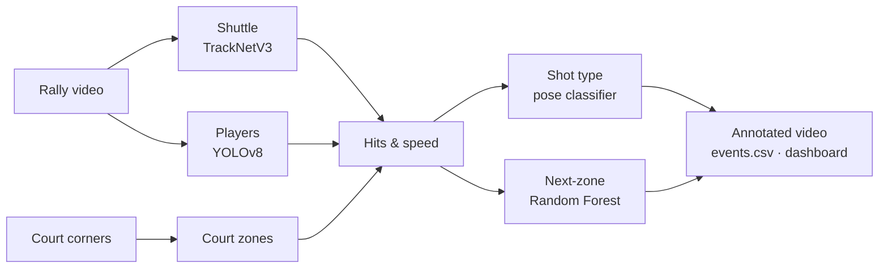

# Badminton AI 🏸

Rally analysis from a single broadcast camera: it tracks both players and the shuttle, finds every hit, measures shot speed, recognises the type of shot from the player's pose, and predicts which zone of the court the shuttle will land in next — shown in an annotated video and an interactive dashboard.


---

## What it does

| Step | How | Code |
|---|---|---|
| **Court** | 4 court corners → homography from pixels to court metres; each half split into 6 zones (F1–F6 far, N1–N6 near) | `badminton/court.py`, `calibrate_court.py`, `auto_calibrate_court.py` |
| **Players** | YOLOv8 person detection, kept to the court; Player 1 = far side, Player 2 = near side | `analyze_match.py` |
| **Shuttle** | [TrackNetV3](https://github.com/qaz812345/TrackNetV3) heatmaps from 8-frame windows, short gaps filled by its InpaintNet | `badminton/tracknet.py` |
| **Hits** | Sharp turns or speed-ups in the shuttle's path; the hit zone is the hitting player's position | `badminton/events.py` |
| **Shot speed** | The shuttle's first moves after the hit, measured on the court plane | `badminton/events.py` |
| **Shot type** | YOLOv8-pose on the hitter around the hit → pose classifier → 6 shot groups (serve, clear/lift, smash, drop/net, drive/push, defensive) | `badminton/shots.py`, `badminton/shot_types.py` |
| **Next zone** | Random Forest on the hit zone, previous zone, speed and the first 0.4 s of flight → probability for each of the opponent's 6 zones | `badminton/predictor.py` |



---

## Results

All numbers are measured on rallies the model did not train on.

| Task | Result | Compared with | Test set |
|---|---|---|---|
| Shuttle position (within 10 px) | **87%**, median error 2.8 px | 36%, 61 px for our earlier YOLO + motion tracker | 737 hand-labelled frames, 16 rallies |
| Hit detection (within 4 frames) | **F1 0.67** (precision 68%, recall 66%); hitter's side right 92% | — | 200 hand-labelled hits, 15 rallies |
| Shot group | **46%** | 33% always guessing the most common group; 19% for the original classifier | 195 hits, leave-one-rally-out |
| Next zone (of 6) | **54.4% top-1 / 81.7% top-2** | 44.9% / 72.6% with YOLO shuttle tracks; 41.1% most common next zone; 16.7% random | 3,413 shots, 362 rallies, 5-fold cross-validation by rally |
| Automatic court corners | median error 4.7 px | hand-clicked corners | — |

Details: `runs/shuttle_eval/benchmark.json`, `runs/shot_eval/hits.json`, `runs/shot_model/broadcast_metrics.json`, `runs/zone_model/metrics.json`.

**Tried and not kept**

- Shot group as an extra next-zone feature: 53.8% vs 54.6% — the shuttle's first moves already carry that information.
- Predicting later (0.53 s or 0.67 s instead of 0.4 s): +0.1 points, within noise.

---

## Run the demo

```bash
git clone https://github.com/Agastyasingh1106/Badminton-AI.git
cd Badminton-AI
pip install -r requirements.txt     # Python 3.10
python download_weights.py          # TrackNetV3 shuttle weights, 142 MB
streamlit run app.py
```

The dashboard opens on the sample rally (00467) with its results already computed. Pick **Upload a video** in the sidebar to analyse another rally: click the 4 court corners, then **▶ Run analysis**. Re-running the sample rally gives the same shots, speeds and predictions as in `runs/analysis/00467/`.

- **Shuttle weights:** TrackNetV3's weights are too big for git, so `download_weights.py` fetches them from this repository's [release](https://github.com/Agastyasingh1106/Badminton-AI/releases/tag/tracknetv3-weights) and checks them. Without them the pipeline falls back to the much less accurate YOLO shuttle tracker, and the dashboard shows a warning.
- **GPU:** on Windows `pip` installs CPU-only PyTorch. With an NVIDIA GPU, install the CUDA build:
  ```bash
  pip install --force-reinstall --no-deps torch==2.14.1+cu130 torchvision==0.29.1+cu130 --index-url https://download.pytorch.org/whl/cu130
  ```

**Command line:** `python analyze_match.py sample_dataset/00467.mp4` writes the annotated video, `events.csv` and `summary.json` to `runs/analysis/00467/`.

**Dashboard tabs:** annotated video · shot table (player, zone, shot group, speed, predicted vs actual next zone) · zone heatmaps · next-zone prediction per shot and model accuracy · player movement.

---

## Retraining

```bash
# Court corners: click them, or fit them automatically for a folder of rallies
python calibrate_court.py
python auto_calibrate_court.py dataset/rallies

# Track the unlabelled broadcast rallies, then train the next-zone model
python track_rallies.py dataset/rallies --ids runs/tracknet/broadcast_ids.txt --shard 0/2
python track_rallies.py dataset/rallies --ids runs/tracknet/broadcast_ids.txt --shard 1/2
python train_zone_predictor.py

# Hand labels, evaluation and the shot classifier
python label_hits.py                 # hits, hitter side, shot type and shuttle positions -> hit_labels.json
python eval_shuttle_tracking.py
python eval_hits.py
python train_shot_classifier.py      # on dataset/shot_keypoints.csv (pose keypoint dataset)
python finetune_shot_classifier.py   # adapts it to broadcast footage as 6 shot groups
```

---

## Repository

```text
app.py                     Streamlit dashboard
analyze_match.py           Full pipeline for one rally → annotated video, events.csv, summary.json
download_weights.py        Fetches the TrackNetV3 weights from the GitHub release
badminton/
  court.py                 Court homography and zones
  tracknet.py              TrackNetV3 shuttle tracking
  events.py                Hits, hit zones, shot speed
  shots.py, shot_types.py  Pose-based shot classifier and shot groups
  predictor.py             Next-zone model features and wrapper
calibrate_court.py         Click court corners  (auto_calibrate_court.py fits them automatically)
track_rallies.py           Track many rallies for training
train_zone_predictor.py    Train and cross-validate the next-zone model
label_hits.py              Labelling tool for hits, shot types and shuttle positions
eval_*.py                  Shuttle-tracking and hit-detection benchmarks
train_shot_classifier.py, finetune_shot_classifier.py
detect_shuttle.py, train_shuttlecock.py, yolo_inference.py   Earlier YOLO shuttle detector (fallback)
third_party/tracknetv3/    Vendored TrackNetV3 (MIT)
runs/                      Trained models, metrics and the sample analysis
sample_dataset/00467.mp4   Sample rally (held out from all training)
```

---

## Limitations and next steps

- **Single camera.** Shot speed is an estimate; smashes from the near-side player read low because the shuttle moves away from the camera and down at the same time.
- **Shot groups are right about half the time.** More labelled hits would help most.
- **Next-zone mistakes** are mostly short-vs-deep: the model falls back to the back-middle zone when unsure. The receiving player's movement after the hit is the most promising next feature.
- **Broadcast footage only.** The practice-hall videos in the dataset are not used.

---

## Credits

- [TrackNetV3](https://github.com/qaz812345/TrackNetV3) (MIT) for shuttle tracking
- [Ultralytics YOLOv8](https://github.com/ultralytics/ultralytics) for player detection and pose
- Rally videos and the pose keypoint dataset from our group's badminton dataset collection

## License
MIT
