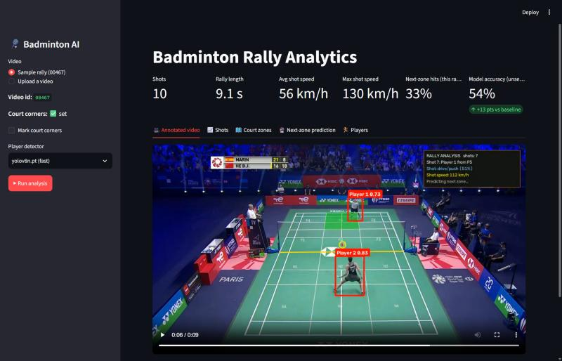
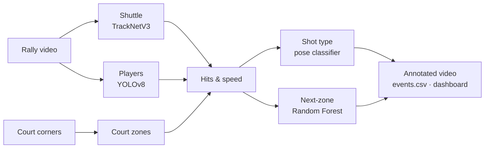

# Badminton AI 🏸

Rally analysis from a single broadcast camera: it tracks both players and the shuttle, finds every hit, measures shot speed, recognises the type of shot from the player's pose, and predicts which zone of the court the shuttle will land in next — shown in an annotated video and an interactive dashboard.



---

## What it does

| Step | How | Code |
|---|---|---|
| **Court** | 4 court corners → homography from pixels to court metres; each half split into 6 zones (F1–F6 far, N1–N6 near) | `badminton/court.py`, `calibrate_court.py`, `auto_calibrate_court.py` |
| **Players** | YOLOv8 person detection, kept to the court; Player 1 = far side, Player 2 = near side | `analyze_match.py` |
| **Shuttle** | [TrackNetV3](https://github.com/qaz812345/TrackNetV3) heatmaps from 8-frame windows, short gaps filled by its InpaintNet | `badminton/tracknet.py` |
| **Hits** | Sharp turns or speed-ups in the shuttle's path; the hit zone is the hitting player's position | `badminton/events.py` |
| **Shot speed** | The shuttle's first moves after the hit, measured on the court plane | `badminton/events.py` |
| **Shot type** | YOLOv8-pose on the hitter around the hit → pose classifier → 6 shot groups (serve, clear/lift, smash, drop/net, drive/push, defensive) | `badminton/shots.py`, `badminton/shot_types.py` |
| **Next zone** | Random Forest on the hit zone, previous zone, speed and the first 0.4 s of flight → probability for each of the opponent's 6 zones | `badminton/predictor.py` |



---

## Results

All numbers are measured on rallies the model did not train on.

| Task | Result | Compared with | Test set |
|---|---|---|---|
| Shuttle position (within 10 px) | **87%**, median error 2.8 px | 36%, 61 px for our earlier YOLO + motion tracker | 737 hand-labelled frames, 16 rallies |
| Hit detection (within 4 frames) | **F1 0.67** (precision 68%, recall 66%); hitter's side right 92% | — | 200 hand-labelled hits, 15 rallies |
| Shot group | **46%** | 33% always guessing the most common group; 19% for the original classifier | 195 hits, leave-one-rally-out |
| Next zone (of 6) | **54.4% top-1 / 81.7% top-2** | 44.9% / 72.6% with YOLO shuttle tracks; 41.1% most common next zone; 16.7% random | 3,413 shots, 362 rallies, 5-fold cross-validation by rally |
| Automatic court corners | median error 4.7 px | hand-clicked corners | — |

Details: `runs/shuttle_eval/benchmark.json`, `runs/shot_eval/hits.json`, `runs/shot_model/broadcast_metrics.json`, `runs/zone_model/metrics.json`.

**Tried and not kept**

- Shot group as an extra next-zone feature: 53.8% vs 54.6% — the shuttle's first moves already carry that information.
- Predicting later (0.53 s or 0.67 s instead of 0.4 s): +0.1 points, within noise.

---

## Run the demo

It runs on any computer with **Python 3.10**. An NVIDIA GPU makes analysing new videos about 3× faster, but everything works on a CPU and gives the same results.

### 1. Get the code and install

```bash
git clone https://github.com/Agastyasingh1106/Badminton-AI.git
cd Badminton-AI
```

Create a virtual environment so the pinned packages don't clash with anything else:

| Windows | macOS / Linux |
|---|---|
| `py -3.10 -m venv .venv` | `python3.10 -m venv .venv` |
| `.venv\Scripts\activate` | `source .venv/bin/activate` |

Then install the packages and download the shuttle-tracking weights (142 MB, from this repository's [release](https://github.com/Agastyasingh1106/Badminton-AI/releases/tag/tracknetv3-weights)):

```bash
pip install -r requirements.txt
python download_weights.py
```

### 2. Pick CPU or GPU

The code uses an NVIDIA GPU automatically when PyTorch can see one, and the CPU otherwise. There is nothing to configure; only the PyTorch build you install matters.

| Your computer | What to do |
|---|---|
| **Windows, no NVIDIA GPU** | Nothing. Step 1 installed the CPU build. |
| **Windows or Linux with an NVIDIA GPU** | Swap in the CUDA build (below). |
| **Linux, no NVIDIA GPU** | Works as is. Optionally swap in the CPU build (below) to save a few GB of disk. |
| **Mac with Apple Silicon (M1–M4)** | Nothing. It runs on the CPU. |
| **Intel Mac** | Not supported: PyTorch 2.14 has no build for it. |
| **AMD or Intel graphics** | Nothing. It runs on the CPU. |

**Swap in the CUDA build (NVIDIA GPU).** Run `nvidia-smi` and look at **CUDA Version** in the top-right corner of its output. Then run the matching command:

| `nvidia-smi` shows | Command |
|---|---|
| CUDA 13.0 or higher | `pip install --force-reinstall --no-deps torch==2.14.1 torchvision==0.29.1 --index-url https://download.pytorch.org/whl/cu130` |
| CUDA 12.6 – 12.9 | `pip install --force-reinstall --no-deps torch==2.14.1 torchvision==0.29.1 --index-url https://download.pytorch.org/whl/cu126` |
| Lower than 12.6 | Update the NVIDIA driver, or stay on the CPU. |

**Swap in the CPU build (Linux, optional):**

```bash
pip install --force-reinstall --no-deps torch==2.14.1 torchvision==0.29.1 --index-url https://download.pytorch.org/whl/cpu
```

Install `requirements.txt` first and swap PyTorch afterwards, as above. Installing PyTorch first from the PyTorch index fails, because one of its dependencies only exists on the normal Python package index.

**Check which one you're on:**

```bash
python -c "import torch; print('GPU:', torch.cuda.get_device_name(0)) if torch.cuda.is_available() else print('CPU')"
```

### 3. Run

```bash
streamlit run app.py
```

The dashboard opens on the sample rally (00467) with its results already computed, so it shows instantly on any machine. Pick **Upload a video** in the sidebar to analyse another rally: click the 4 court corners, then **▶ Run analysis**.

How long analysing the 9-second sample rally takes (measured on one laptop):

| Hardware | Time |
|---|---|
| NVIDIA RTX 4050 Laptop GPU | 41 s |
| CPU only (AMD Ryzen 7 8845HS) | 118 s |

CPU and GPU give the same shots, zones, speeds, shot groups and predictions. Only the shot-group confidence can differ in its last digit.

Without the downloaded weights the pipeline falls back to a much less accurate shuttle tracker, and the dashboard shows a warning.

**Command line:** `python analyze_match.py sample_dataset/00467.mp4` writes the annotated video, `events.csv` and `summary.json` to `runs/analysis/00467/`.

**Dashboard tabs:** annotated video · shot table (player, zone, shot group, speed, predicted vs actual next zone) · zone heatmaps · next-zone prediction per shot and model accuracy · player movement.

---

## How the models were trained

> **You don't need this to run the demo or analyse new videos.** The trained models are already in the repository. This section shows how they and the results above were produced.
>
> Most of these steps need data that is too big for GitHub and is not in this repository:
> - `dataset/rallies/`: 400 rally videos (`00401.mp4` … `00800.mp4`) from our group's badminton dataset
> - `dataset/shot_keypoints.csv`: the pose keypoint dataset for the shot classifier (258 MB)
>
> Put them at those paths to rerun everything.

**1. Court corners** — click them for one video, or fit them automatically for a folder of rallies. Already done: all corners are in `court_corners.json`.

```bash
python calibrate_court.py                      # works from the repository as is
python auto_calibrate_court.py dataset/rallies # needs the rally videos
```

**2. Next-zone model** — track the 320 broadcast rallies listed in `runs/tracknet/broadcast_ids.txt` (practice-hall footage left out), then train and cross-validate. Without the tracked rallies, `train_zone_predictor.py` still runs but only learns from the 44 labelled rallies and scores lower than the 54% above.

```bash
python track_rallies.py dataset/rallies --ids runs/tracknet/broadcast_ids.txt --shard 0/2
python track_rallies.py dataset/rallies --ids runs/tracknet/broadcast_ids.txt --shard 1/2
python train_zone_predictor.py
```

**3. Hand labels and benchmarks** — `hit_labels.json` (in the repository) holds 200 hand-labelled hits and shuttle positions from 15 rallies. The benchmarks score the pipeline against them and need the rally videos.

```bash
python label_hits.py              # the labelling tool used to make hit_labels.json
python eval_shuttle_tracking.py   # shuttle tracking accuracy
python eval_hits.py               # hit detection accuracy
```

**4. Shot classifier** — train it on the pose keypoint dataset, then adapt it to broadcast footage as 6 shot groups using the hand-labelled hits.

```bash
python train_shot_classifier.py      # needs dataset/shot_keypoints.csv
python finetune_shot_classifier.py   # needs the rally videos
```

---

## Repository

```text
app.py                     Streamlit dashboard
analyze_match.py           Full pipeline for one rally → annotated video, events.csv, summary.json
download_weights.py        Fetches the TrackNetV3 weights from the GitHub release
badminton/
  court.py                 Court homography and zones
  tracknet.py              TrackNetV3 shuttle tracking
  events.py                Hits, hit zones, shot speed
  shots.py, shot_types.py  Pose-based shot classifier and shot groups
  predictor.py             Next-zone model features and wrapper
calibrate_court.py         Click court corners  (auto_calibrate_court.py fits them automatically)
track_rallies.py           Track many rallies for training
train_zone_predictor.py    Train and cross-validate the next-zone model
label_hits.py              Labelling tool for hits, shot types and shuttle positions
eval_*.py                  Shuttle-tracking and hit-detection benchmarks
train_shot_classifier.py, finetune_shot_classifier.py
detect_shuttle.py, train_shuttlecock.py, yolo_inference.py   Earlier YOLO shuttle detector (fallback)
third_party/tracknetv3/    Vendored TrackNetV3 (MIT)
runs/                      Trained models, metrics and the sample analysis
sample_dataset/00467.mp4   Sample rally (held out from all training)
```

---

## Limitations and next steps

- **Single camera.** Shot speed is an estimate; smashes from the near-side player read low because the shuttle moves away from the camera and down at the same time.
- **Shot groups are right about half the time.** More labelled hits would help most.
- **Next-zone mistakes** are mostly short-vs-deep: the model falls back to the back-middle zone when unsure. The receiving player's movement after the hit is the most promising next feature.
- **Broadcast footage only.** The practice-hall videos in the dataset are not used.

---

## Credits

- [TrackNetV3](https://github.com/qaz812345/TrackNetV3) (MIT) for shuttle tracking
- [Ultralytics YOLOv8](https://github.com/ultralytics/ultralytics) for player detection and pose
- Rally videos and the pose keypoint dataset from our group's badminton dataset collection

## License
MIT
